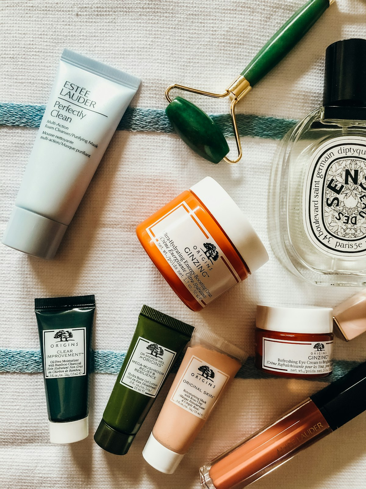

# ✨ LUMI GLOW // Radiant Clean Beauty & Skincare Boutique

<div align="center">



### **UNLEASH YOUR NATURAL RADIANCE. CLEAN. ETHICAL. LUMINESCENT.**
*A contemporary multi-page luxury beauty & cosmetics e-commerce platform crafted with Tailwind CSS and responsive Vanilla JavaScript.*

[](https://github.com/zarmeenhussain/lumi_glow)
[](https://github.com)
[](https://tailwindcss.com)
[](https://github.com/zarmeenhussain/lumi_glow)

[Explore Products](#-curated-product-catalog) • [Watch Demo](#-walkthrough-video-demo) • [Features](#-interactive-features--uiux) • [Tomorrow Push Guide](#-tomorrow-push--github-collaboration-guide) • [Setup](#-getting-started)

</div>

---

## 📽️ Walkthrough Video Demo

Experience the dynamic shopping flow—from category filtering and real-time cart manipulation to authentication screens and responsive views:

<div align="center">
  <video src="demovideo/demo.mp4" controls="controls" width="100%" style="max-height: 520px; border-radius: 12px; border: 1px solid #FBCFE8; box-shadow: 0 10px 30px rgba(236,72,153,0.15);">
    Your browser does not support the video tag. You can directly view <a href="demovideo/demo.mp4">demovideo/demo.mp4</a>.
  </video>
  <br>
  <p align="center">
    <sub>🎬 High-definition demo walkthrough recorded directly from the application. File available in <code>demovideo/demo.mp4</code>.</sub>
  </p>
</div>

---

## 📖 Table of Contents

- [🌸 Brand Philosophy](#-brand-philosophy)
- [📽️ Walkthrough Video Demo](#️-walkthrough-video-demo)
- [✨ Interactive Features & UI/UX](#-interactive-features--uiux)
- [💄 Curated Product Catalog](#-curated-product-catalog)
- [🛠️ Technology Stack](#️-technology-stack)
- [📂 Project Architecture](#-project-architecture)
- [🚀 Getting Started](#-getting-started)
- [🤝 Tomorrow Push & GitHub Collaboration Guide](#-tomorrow-push--github-collaboration-guide)
- [👥 Creators & Mentorship](#-creators--mentorship)
- [📄 License](#-license)

---

## 🌸 Brand Philosophy

**LUMI GLOW** celebrates clean, scientifically proven formulas blended with botanical extracts. Designed for individuals who demand transparency, dermatological gentleness, and effortless glow:

- **100% Cruelty-Free & Vegan**: Certified ethical cosmetic formulation.
- **Micro-Biome Friendly**: Zero parabens, sulfates, or harsh synthetic aromas.
- **Glass-Skin Finish**: Lightweight, breathable textures that nourish and illuminate.
- **Sustainable Packaging**: Recyclable frosted glass bottles and biodegradable cartons.

---

## ✨ Interactive Features & UI/UX

### 1. 🛍️ Dynamic Multi-Category Catalog
- Complete showcase across **4 core beauty disciplines**: `Skincare`, `Makeup`, `Haircare`, and `Fragrance`.
- Real-time client-side category filters with instant DOM rendering.

### 2. 🛒 Persistent LocalStorage Shopping Cart
- Seamless add-to-bag capability with real-time badge count updates.
- Persistent across page reloads via browser `localStorage`.
- Intuitive slide-out toast notifications confirming item additions.

### 3. 🔍 Live Product Search & Filter
- Real-time client search bar with instant query matching across titles and categories.
- Automatic empty-state feedback with graceful fallback suggestions.

### 4. 📄 Multi-Page Architecture
- **Home (`index.html`)**: Editorial hero banner, trending picks, category cards, verified customer reviews, and newsletter capture.
- **Catalog (`products.html`)**: Interactive grid, filter tabs, price tags, and direct cart actions.
- **Story (`about.html`)**: Brand ethos, clinical testing standards, founder note, and sustainability pillars.
- **Contact (`contact.html`)**: Interactive customer support inquiry form and FAQ accordion.
- **Auth (`login.html`, `signup.html`, `auth.html`)**: User authentication and VIP club portal UI.

---

## 💄 Curated Product Catalog

Every item in the LUMI GLOW collection is backed by dedicated local assets in [`assets/images/`](assets/images/):

| ID | Product Name | Category | Price | Rating | Local Asset |
|:--:|:-------------|:---------|:-----:|:------:|:------------|
| **01** | HydraGlow Serum | Skincare | $28.00 | 4.8 ★ | [`assets/images/prod-serum.jpg`](assets/images/prod-serum.jpg) |
| **02** | Velvet Finish Foundation | Makeup | $32.00 | 4.6 ★ | [`assets/images/prod-foundation.jpg`](assets/images/prod-foundation.jpg) |
| **03** | Rose Cloud Blush | Makeup | $18.00 | 4.7 ★ | [`assets/images/prod-blush.jpg`](assets/images/prod-blush.jpg) |
| **04** | Silk Repair Hair Oil | Haircare | $22.00 | 4.5 ★ | [`assets/images/prod-hairoil.jpg`](assets/images/prod-hairoil.jpg) |
| **05** | Noir Eau de Parfum | Fragrance | $54.00 | 4.4 ★ | [`assets/images/prod-noir-perfume.jpg`](assets/images/prod-noir-perfume.jpg) |
| **06** | Pure Balance Cleanser | Skincare | $16.00 | 4.3 ★ | [`assets/images/prod-cleanser.jpg`](assets/images/prod-cleanser.jpg) |
| **07** | Luxe Lip Tint | Makeup | $14.00 | 4.2 ★ | [`assets/images/prod-liptint.jpg`](assets/images/prod-liptint.jpg) |
| **08** | Radiance Day Cream | Skincare | $24.00 | 4.6 ★ | [`assets/images/prod-daycream.jpg`](assets/images/prod-daycream.jpg) |
| **09** | Amber Musk Eau de Parfum | Fragrance | $49.00 | 4.1 ★ | [`assets/images/prod-ambermusk.jpg`](assets/images/prod-ambermusk.jpg) |
| **10** | Curl Define Styling Cream | Haircare | $19.00 | 4.0 ★ | [`assets/images/prod-curlcream.jpg`](assets/images/prod-curlcream.jpg) |
| **11** | Glow Drops Liquid Highlighter | Makeup | $20.00 | 4.4 ★ | [`assets/images/prod-highlighter.jpg`](assets/images/prod-highlighter.jpg) |
| **12** | Calm Night Moisture Mask | Skincare | $26.00 | 4.9 ★ | [`assets/images/prod-nightmask.jpg`](assets/images/prod-nightmask.jpg) |

---

## 🛠️ Technology Stack

- **Markup**: Clean, semantic HTML5 with accessibility landmark tags
- **Styling**: Tailwind CSS (Utility-first framework via CDN)
- **Typography**: Google Fonts — *Poppins* (Modern, elegant geometric sans-serif)
- **Scripting**: Pure Vanilla JavaScript ES6+ (State management, DOM rendering, localStorage)
- **Media**: Optimized localized JPEG photography and MP4 walkthrough demonstration

---

## 📂 Project Architecture

```
lumi_glow/
├── index.html          # Brand homepage & trending showcases
├── products.html       # Full catalog with dynamic filter & cart
├── about.html          # Brand story, clinical values & philosophy
├── contact.html        # Customer support portal & FAQs
├── login.html          # User login interface
├── signup.html         # VIP member registration
├── auth.html           # Unified authentication gateway
├── README.md           # Master documentation & collaboration guide
├── LICENSE             # MIT Open Source License
├── .gitignore          # Repository clean-slate rules
├── demovideo/
│   └── demo.mp4        # Clean, full-length video walkthrough (11.4 MB)
└── assets/
    ├── app.js          # Core application logic & state engine
    └── images/         # 100% Localized, high-resolution product & category photography
        ├── hero-banner.jpg
        ├── about-model.jpg
        ├── cat-skincare.jpg
        ├── cat-makeup.jpg
        ├── cat-haircare.jpg
        ├── cat-fragrance.jpg
        ├── prod-serum.jpg
        ├── prod-foundation.jpg
        ├── prod-blush.jpg
        ├── prod-hairoil.jpg
        ├── prod-noir-perfume.jpg
        ├── prod-cleanser.jpg
        ├── prod-liptint.jpg
        ├── prod-daycream.jpg
        ├── prod-ambermusk.jpg
        ├── prod-curlcream.jpg
        ├── prod-highlighter.jpg
        └── prod-nightmask.jpg
```

---

## 🚀 Getting Started

To run the application locally on your machine:

```bash
# 1. Open the project folder in terminal
cd "C:\Users\zohair_hingoro\Desktop\zarmeen_projects\lumi_glow"

# 2. Launch with Python's built-in HTTP server
python -m http.server 3000

# OR launch with Node.js
npx serve .
```

Open your browser and navigate to `http://localhost:3000`.

---

## 🤝 Tomorrow Push & GitHub Collaboration Guide

This repository is designated to be **published primarily under Zarmeen Hussain's GitHub profile** with a **connected fork by Zohair Hingoro**, ensuring both profiles receive maximum contribution graph activity and achievement awards.

### Step 1: Create the Repository Tomorrow (Under Zarmeen's Account)
1. Log into **[github.com/zarmeenhussain](https://github.com/zarmeenhussain)**.
2. Go to **[github.com/new](https://github.com/new)**.
3. Repository name: **`lumi_glow`**
4. Set to **Public**.
5. Leave all checkboxes **unchecked** (No README, No .gitignore, No license).
6. Click **Create repository**.

---

### Step 2: Push from Local Machine
In your PowerShell terminal:

```powershell
cd "C:\Users\zohair_hingoro\Desktop\zarmeen_projects\lumi_glow"

# Add Zarmeen's remote
git remote add origin https://github.com/zarmeenhussain/lumi_glow.git

# Push main branch
git push -u origin main
```

---

### Step 3: Fork to Zohair's Profile
1. Log into **[github.com/Zohairhingoro](https://github.com/Zohairhingoro)**.
2. Navigate to **`https://github.com/zarmeenhussain/lumi_glow`**.
3. Click the **Fork** button in the top right.
4. The repository will now be linked on Zohair's profile with the badge *forked from zarmeenhussain/lumi_glow*!

---

### Step 4: Add Collaborator Access
1. In Zarmeen's account, go to **Settings** ➔ **Collaborators** ➔ **Add people**.
2. Add **`Zohairhingoro`**.
3. Accept the invite on Zohair's account.

---

## 👥 Creators & Mentorship

<div align="center">

| Developer | Role | GitHub Profile |
|-----------|------|----------------|
| **Zarmeen Hussain** | Lead Developer & UI/UX Designer | [@zarmeenhussain](https://github.com/zarmeenhussain) |
| **Zohair Hingoro** | Lead Tutor & Architectural Mentor | [@Zohairhingoro](https://github.com/Zohairhingoro) |

*Designed and engineered with passion, mutual learning, and uncompromising visual elegance.*

</div>

---

## 📄 License

This project is licensed under the [MIT License](LICENSE) — free for educational, personal, and commercial study.
